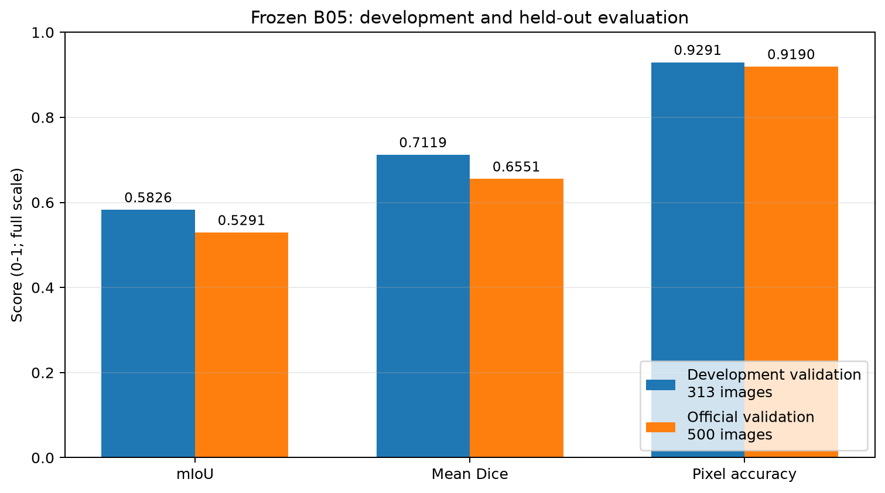
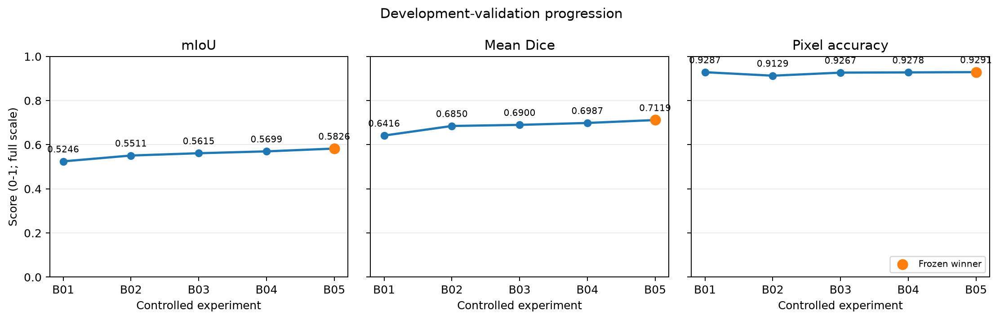
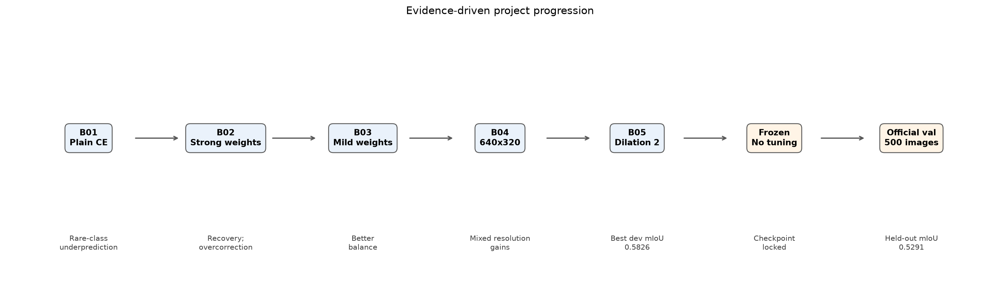
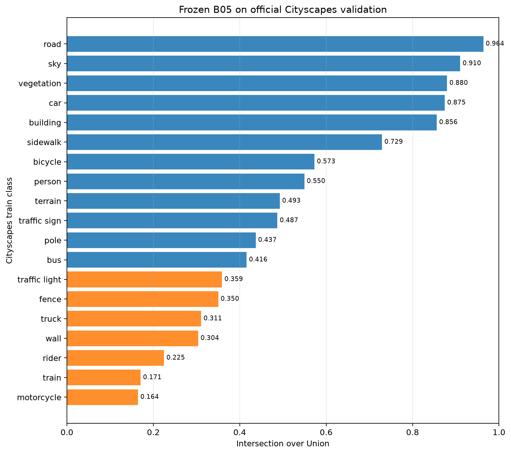
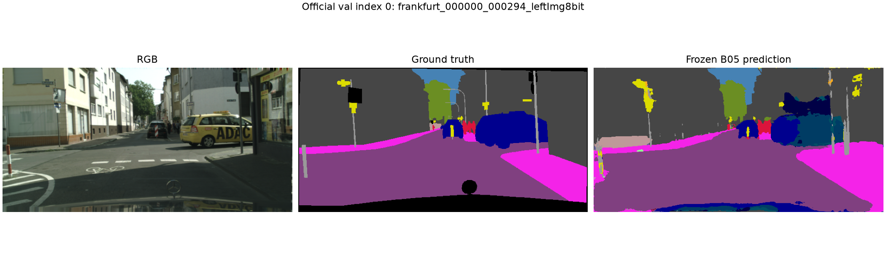
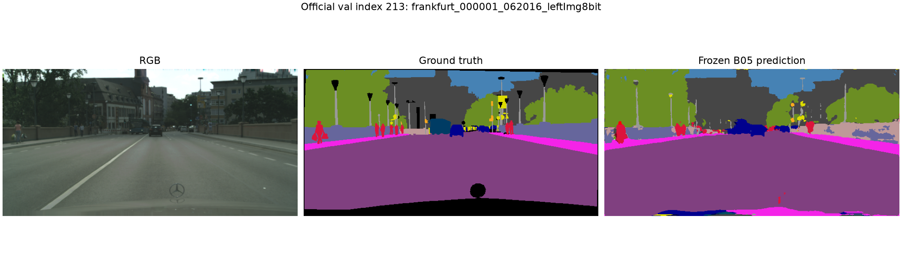
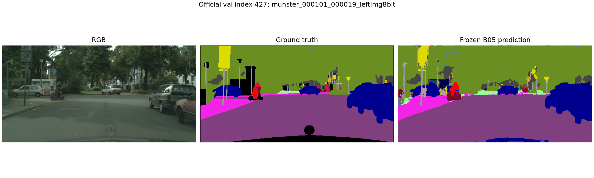

# Cityscapes Semantic Segmentation

End-to-end 19-class Cityscapes semantic-segmentation project built around a custom U-Net, a reproducible data pipeline, controlled one-variable experiments, failure analysis, and a frozen held-out evaluation.

The repository covers the complete engineering path from raw-data audit and official label integration through deterministic splitting, paired transforms, confusion-matrix metrics, checkpointed training, five controlled baselines, and a single evaluation of the frozen development winner on untouched official validation data.

## Key results

| Evaluation stage | Model | Images | mIoU | Mean Dice | Pixel accuracy |
|---|---|---:|---:|---:|---:|
| Development validation | **Baseline 05 — dilated bottleneck** | 313 | **0.582557** | **0.711907** | **0.929086** |
| Official held-out validation | Frozen Baseline 05 | 500 | **0.529051** | **0.655063** | **0.919040** |

Baseline 05 is the **frozen development winner**, selected before the official validation set was opened. The official result is a one-time held-out evaluation, not a second model-selection stage. No local semantic metrics were computed on the official test split.



## Problem and scope

The task is dense semantic prediction for the 19 standard Cityscapes train IDs (`0..18`), with target value `255` excluded from loss and metrics. The project emphasizes transparent experimental reasoning: data membership, class semantics, preprocessing, model state, and every controlled change are auditable.

This work does not claim state-of-the-art performance, production readiness, or official test-set results.

## Dataset and split discipline

The project uses Cityscapes `leftImg8bit` RGB images and `gtFine` semantic annotations. Raw IDs are interpreted through [`cityscapesscripts`](https://github.com/mcordts/cityscapesScripts), the authoritative label source used by the code.

| Official split | Images | Project use |
|---|---:|---|
| `train` | 2,975 | City-separated development train and development validation |
| `val` | 500 | Kept untouched during development; evaluated once after freezing B05 |
| `test` | 1,525 | Not used for local semantic metrics |

The deterministic split in [`configs/splits/cityscapes_dev_split.json`](configs/splits/cityscapes_dev_split.json) divides official train into:

- **Development train:** 2,662 images from 15 cities.
- **Development validation:** 313 images from `jena`, `krefeld`, and `ulm`.

City-level separation reduces location leakage relative to random image splitting. The read-only dataset audit also verified all train/validation image-mask pairs, 2048×1024 dimensions, split/city integrity, absence of duplicate image content across splits, official raw-ID behavior, and substantial class imbalance. Detailed evidence is retained in [`reports/dataset_audit.md`](reports/dataset_audit.md), [`reports/class_pixel_frequencies.csv`](reports/class_pixel_frequencies.csv), and [`reports/city_class_distribution.csv`](reports/city_class_distribution.csv).

Raw images, annotations, checkpoints, and generated experiment outputs remain local and Git-ignored.

## Data pipeline

`CityscapesSegmentationDataset` receives already-resolved membership and pairs each RGB image with its `*_gtFine_labelIds.png` target.

| Component | Contract |
|---|---|
| Label mapping | Official raw IDs → train IDs `0..18`; ignored labels → `255` |
| Final image tensor | `[3, 320, 640]`, `torch.float32` |
| Final target tensor | `[320, 640]`, `torch.int64` |
| Image resize | Bilinear interpolation |
| Mask resize | Nearest-neighbor interpolation |
| Normalization | ImageNet mean and standard deviation |
| Training augmentation | Synchronized horizontal flip, `p=0.5` |
| Validation preprocessing | Deterministic resize; no augmentation or TTA |

Nearest-neighbor mask interpolation preserves categorical IDs. Unknown raw IDs raise an error instead of being silently remapped.

## Frozen model

The final development winner is a custom U-Net trained from scratch:

```text
Input       [B, 3, 320, 640]
Encoder     64 → 128 → 256 → 512
Bottleneck  1024 channels, dilation=2
Decoder     512 → 256 → 128 → 64
Classifier  64 → 19
Output      [B, 19, 320, 640] raw logits
```

- Four encoder and four decoder stages.
- BatchNorm/ReLU double-convolution blocks.
- Max-pooling, transposed-convolution upsampling, and skip concatenation.
- `base_channels=64`, 19 output classes.
- **31,038,803 trainable parameters.**
- No pretrained encoder.

Setting bottleneck dilation to 2 changes each bottleneck convolution's effective sampling footprint from 3×3 to 5×5 while preserving feature-map dimensions, channel counts, and parameter count.

## Evaluation methodology

Metrics come from one accumulated 19×19 confusion matrix over each complete evaluation pass:

- rows are ground-truth classes;
- columns are predicted classes;
- target pixels equal to `255` are excluded;
- mIoU is the primary model-selection metric;
- per-class IoU, Dice, and pixel accuracy are secondary metrics;
- absent-class values are omitted from macro means rather than treated as zero.

The implementation never averages batch-level IoUs.

## Controlled experiment progression

Every baseline changed one predeclared mechanism while preserving the development split and selection rule.

| Experiment | Controlled change | Resolution | Best epoch | Dev mIoU | Mean Dice | Pixel accuracy |
|---|---|---:|---:|---:|---:|---:|
| B01 | Plain cross-entropy | 512×256 | 26 | 0.524634 | 0.641598 | 0.928686 |
| B02 | Frequency^-0.5 weighted CE | 512×256 | 28 | 0.551079 | 0.684990 | 0.912909 |
| B03 | Frequency^-0.25 weighted CE | 512×256 | 30 | 0.561506 | 0.689985 | 0.926736 |
| B04 | Higher resolution only | 640×320 | 30 | 0.569926 | 0.698703 | 0.927832 |
| **B05** | **Dilated bottleneck only** | **640×320** | **30** | **0.582557** | **0.711907** | **0.929086** |



The progression was evidence-driven:

- **B01:** plain CE exposed severe rare-class underprediction.
- **B02:** stronger inverse-frequency weighting recovered rare classes but caused broad overprediction and common-class regressions.
- **B03:** milder weighting retained useful rare-class gains while restoring common-class balance.
- **B04:** higher resolution improved aggregate performance, but class-level effects were mixed and scene-sensitive.
- **B05:** bottleneck dilation broadened context sampling and produced the best development mIoU, including a strong truck recovery, while motorcycle remained a tradeoff.

The project stopped after B05: five controlled hypotheses had established a clear winner, remaining errors were increasingly sparse and city-specific, and further development tuning risked becoming hyperparameter fishing.



### Locked B05 training configuration

| Setting | Value |
|---|---|
| Loss | Weighted `CrossEntropyLoss(ignore_index=255)` |
| Class weights | Dev-train-only normalized frequency^-0.25 |
| Optimizer | AdamW |
| Learning rate / weight decay | `1e-3` / `1e-4` |
| Batch size | 2 |
| Epochs | 30; no early stopping |
| Scheduler | CosineAnnealingLR, `T_max=30`, `eta_min=1e-5` |
| Seed / precision | 42 / FP32 |
| Model selection | Highest city-separated development-validation mIoU |

## Final held-out evaluation

After freezing Baseline 05, its epoch-30 checkpoint was evaluated **exactly once** on all 500 images in the untouched official Cityscapes validation split.

There was no retraining, checkpoint reselection, threshold tuning, test-time augmentation, preprocessing change, or post-hoc model change. The evaluation used 640×320 deterministic preprocessing, FP32 CUDA inference, and a single confusion matrix accumulated across all valid pixels.

| Metric | Development validation | Official validation | Gap |
|---|---:|---:|---:|
| mIoU | 0.582557 | **0.529051** | -0.053506 |
| Mean Dice | 0.711907 | **0.655063** | -0.056844 |
| Pixel accuracy | 0.929086 | **0.919040** | -0.010045 |

### Official-validation per-class IoU

| Class | IoU | Class | IoU |
|---|---:|---|---:|
| road | 0.9638 | sidewalk | 0.7292 |
| building | 0.8559 | wall | 0.3038 |
| fence | 0.3503 | pole | 0.4370 |
| traffic light | 0.3590 | traffic sign | 0.4870 |
| vegetation | 0.8797 | terrain | 0.4926 |
| sky | 0.9103 | person | 0.5496 |
| rider | 0.2248 | car | 0.8746 |
| truck | 0.3107 | bus | 0.4158 |
| train | 0.1706 | motorcycle | 0.1645 |
| bicycle | 0.5729 |  |  |



## Generalization and limitations

The held-out mIoU was `0.053506` below development validation. Large structural classes—road, sky, vegetation, car, and building—generalized strongly. Train, motorcycle, terrain, truck, and rider showed the largest IoU drops.

Official-validation class composition also differed from the three development-validation cities: bicycle, rider, bus, and thin street-object shares were higher, while train, wall, terrain, and motorcycle shares were lower. These differences are descriptive context, not proof that composition alone caused the generalization gap.

Remaining limitations include:

- sparse-class and city/scene sensitivity;
- semantic interchange among related vehicles;
- weak rider and motorcycle separation;
- boundary/detail errors for thin structures;
- a custom U-Net whose capacity and context handling remain modest relative to modern segmentation architectures;
- one local hardware/software environment and no official test-set metrics.

The held-out result demonstrates why development metrics alone are insufficient and is reported without further model adjustment.

## Qualitative official-validation examples

These are fixed indices from the evaluator's evenly spaced deterministic sample set—not performance-ranked or cherry-picked examples. Each panel shows RGB, ground truth, and the frozen B05 prediction.

<p align="center">
  
  
  
</p>

## Engineering highlights

- Immutable, Git-ignored raw dataset with a read-only integrity audit.
- Deterministic city-level development split and leakage checks.
- Official raw-label → train-ID mapping with explicit unknown-ID failures.
- Synchronized image/mask transforms with interpolation-safe masks.
- Confusion-matrix metrics accumulated over complete evaluation passes.
- Checkpoint save/resume and backward-compatible state-dict loading.
- Reproducible locked experiment runners and incremental histories.
- Controlled one-variable experiments supported by targeted failure analysis.
- CUDA memory feasibility probes before higher-resolution training.
- Frozen, one-time held-out official-validation evaluation.

## Reproducibility

Major scripts:

```text
scripts/
  inspect_cityscapes.py
  compute_class_weights.py
  run_baseline_01.py ... run_baseline_05.py
  analyze_baseline_01.py ... analyze_baseline_05.py
  evaluate_official_val.py
  generate_readme_figures.py
```

Core package structure:

```text
configs/splits/                  Deterministic split manifest
reports/                         Tracked dataset-audit summaries
docs/figures/                    Tracked portfolio figures
src/cityscapes_segmentation/
  data/                          Labels, splits, Dataset, transforms
  models/                        Custom U-Net
  engine/                        Training, validation, checkpoints
  analysis/                      Confusion-matrix metrics
tests/                           Unit and local integration tests
```

### Environment setup

The verified Windows environment uses Python 3.12.10, PyTorch `2.13.0+cu130`, torchvision `0.28.0+cu130`, and CUDA 13.0.

```powershell
py -3.12 -m venv .venv
.\.venv\Scripts\Activate.ps1
python -m pip install --upgrade pip
python -m pip install torch==2.13.0+cu130 torchvision==0.28.0+cu130 --index-url https://download.pytorch.org/whl/cu130
python -m pip install -r requirements.txt
python -m pip install -r requirements-dev.txt
python -c "import torch; print(torch.__version__, torch.cuda.is_available())"
pytest -q
```

Place `leftImg8bit/` and `gtFine/` under the project root. Experiment runners guard existing output/checkpoint directories against accidental overwrite. README charts are regenerated from verified embedded summary metrics:

```powershell
python scripts/generate_readme_figures.py
```

## Testing and hardware

**81 tests currently pass**, covering label mapping, split integrity, transforms, Dataset behavior, metrics, U-Net configuration, training/validation behavior, checkpoint compatibility, and class weighting.

Reported experiments ran on an NVIDIA GeForce RTX 3050 Laptop GPU with 4 GB VRAM. Baseline 05 used FP32 with batch size 2; official-validation inference processed 500 images in approximately 113 seconds at 4.43 images/second, with approximately 1,000 MiB peak allocated and 1,418 MiB peak reserved CUDA memory. These are local workflow measurements, not general hardware benchmarks.

## Dataset source and license

Cityscapes must be obtained separately from the [official Cityscapes website](https://www.cityscapes-dataset.com/). This repository does not redistribute images, annotations, or dataset archives. Use remains subject to the official Cityscapes license and terms.

The official test split was not evaluated locally for semantic metrics.
